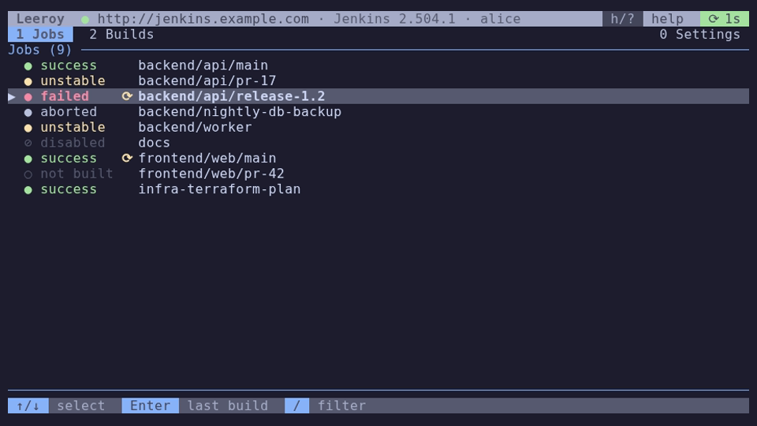
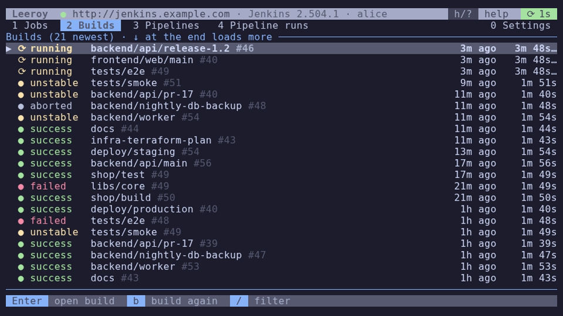
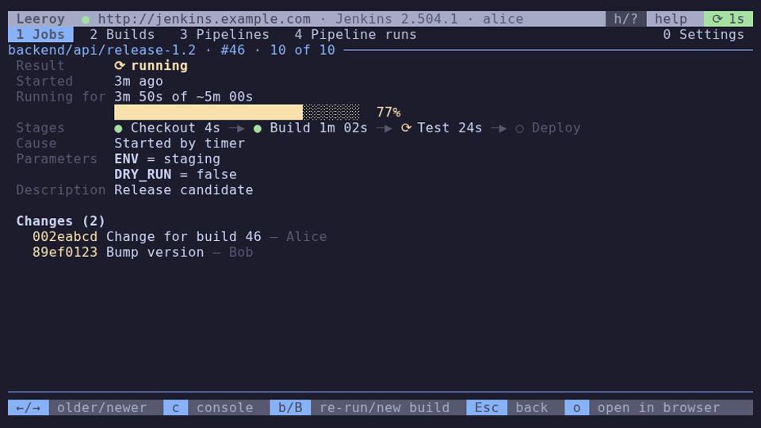
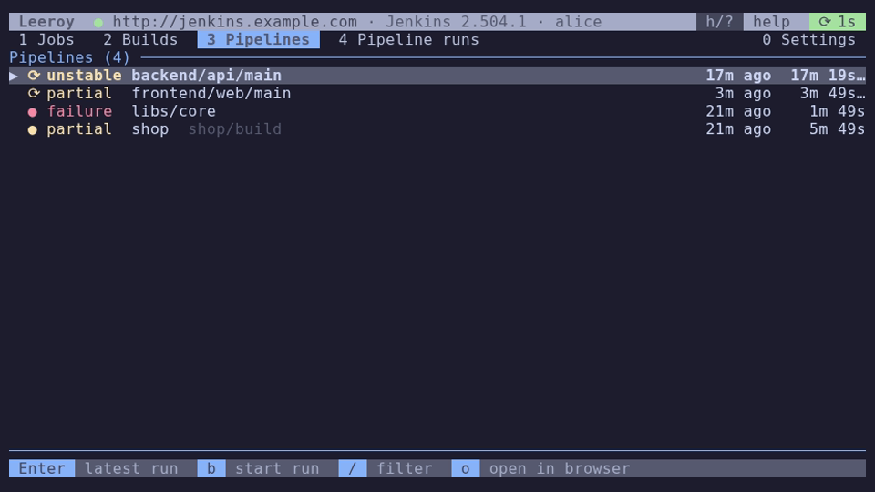
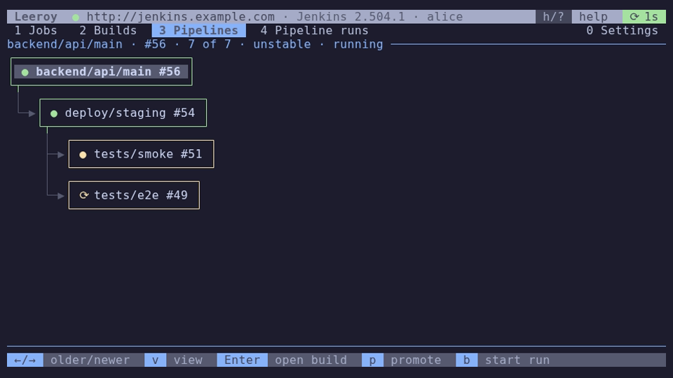

Leeroy is a terminal UI for Jenkins: jobs, build history, pipelines and their
runs, console output, re-running and promoting builds, without leaving the
terminal.

- [Installing](Installing.md): release archives, building from source
- [Configuration](Configuration.md): the config file, env vars, TLS, colours
- [Connecting](Connecting.md): authentication (basic, Keycloak / OpenID
  Connect, headers), proxies
- [Using Leeroy](Using-Leeroy.md): tabs and global keys
- [Jobs and Builds](Jobs-and-Builds.md): job list, build details, console
  output, build history
- [Pipelines](Pipelines.md): pipelines, their runs, promotions, re-running
- [Troubleshooting](Troubleshooting.md): logs, debug output, common problems
- [Development](Development.md): architecture, CI, releasing, these docs

The jobs of an instance, with their last result and running builds:

The build history of all jobs, newest first:

A build's details, here a running one with its progress:

Pipelines (jobs that trigger other jobs) with the status of their latest run:

A run: the builds it triggered, as a tree or (with `v`, shown here) as boxes:

